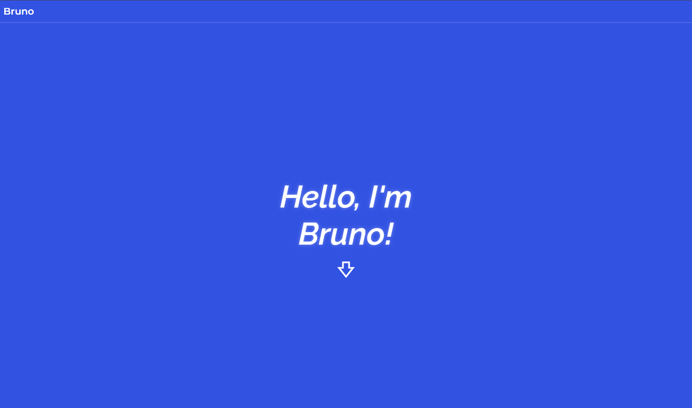
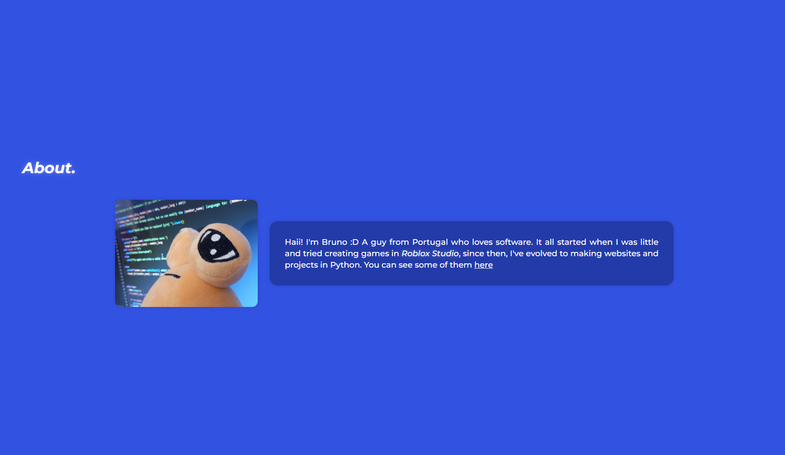
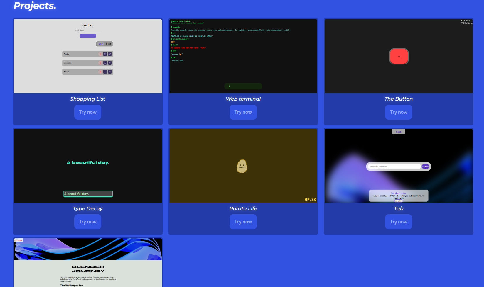

# My Portfolio

This project is a modern portolfio that I created to share some of my projects and a bit about myself with anyone.

You can try it [here](https://brundevcoder.github.io/portfolio2/)

## What sections does the portfolio have?

- **About**: It shows a little bit of me and my journey.

- **Projects**: It shows some of my projects.

## About the design
This project uses two fonts, "Raleway" and "Montserrat" imported from Google Fonts.
It also uses the color blue a lot, more specifically `#3252e2`.

## How to run it locally
You can just open the `index.html` file and it should display everything, or you can use the live server extension from Vs Code to open it.